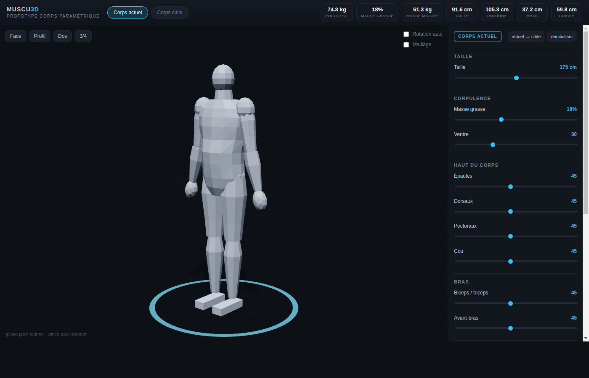

# Muscu3D — prototype corps paramétrique

Prototype local qui valide la brique centrale du projet : **un avatar 3D low-poly
entièrement procédural, piloté par un vecteur corporel**.

Aucun asset externe, aucune API, aucun compte : React + Three.js, tout tourne dans le
navigateur.



## Lancer

```bash
npm install
npm run dev
```

Puis ouvrir <http://127.0.0.1:5173>.

Autres commandes :

```bash
npm run typecheck   # TypeScript strict, aucun emit
npm run build       # build de production dans dist/
npm run preview     # sert le build sur http://127.0.0.1:4173
```

## Ce qui fonctionne déjà

- **Corps paramétrique** : 13 réglages (taille, masse grasse, ventre, épaules, dorsaux,
  pectoraux, cou, biceps, avant-bras, abdos, fessiers, cuisses, mollets).
- **Deux profils** : « Corps actuel » et « Corps cible », avec bouton de copie
  actuel → cible. Chaque profil est mémorisé séparément dans `localStorage`.
- **Profils types** : Sec, Athlétique, Bodybuilder, Massif.
- **Mesures estimées en direct** : poids, masse maigre, tour de taille, de poitrine,
  de bras et de cuisse.
- **Mise en scène** : caméra orbitale, vues Face / Profil / Dos / 3-4, rotation auto,
  affichage du maillage (le « net » low-poly), sol et anneau d'accent (bleu = actuel,
  vert = cible).
- **Deep links de test** : `?mode=target&view=profil&wire=1&preset=bodybuilder`.

## Architecture

```
src/
  lib/
    geometry.ts   loft de sections elliptiques, volume signé, périmètre d'ellipse
    body.ts       BodyParams (le vecteur d'état), mapping régions → géométrie,
                  construction des parties, estimations
  scene/
    viewer.ts     scène Three.js : lumières, sol, ombres, caméra, anneau
  App.tsx         UI (sliders, profils, mesures), état, persistance
  styles.css      thème sombre, layout tablette + repli mobile
```

Le principe structurant : **le vecteur `BodyParams` est la vérité**, le maillage n'est
qu'une projection. La simulation et le programme viendront brancher leurs calculs sur
ce même vecteur.

## Limites assumées (v0)

- Le **poids** est déduit du volume du maillage (facteur de calibrage), et les
  **mensurations** de périmètres d'ellipses : ce sont des estimations visuelles, pas
  des mesures médicales.
- Pas encore de **projection dans le temps**, de **jauge de faisabilité**, de
  **programme d'entraînement**, de **nutrition**, ni de **timeline bimensuelle**.
- Les proportions sont stylisées (pas de morphologie féminine, pas de visage).

## Prochaines étapes

1. Simulateur : allocation régionale de la croissance selon le programme, cinétique
   réaliste, budget d'erreur honnête (± kg).
2. Jauge de faisabilité objectif vs horizon, avec explication des limites.
3. Générateur de programme adapté au matériel (salle / maison / rien) et à l'horizon.
4. Volet nutrition conditionnel (prise de masse, sèche, maintien).
5. Mise à jour bimensuelle du vecteur corporel + timeline avant/après 3D.
